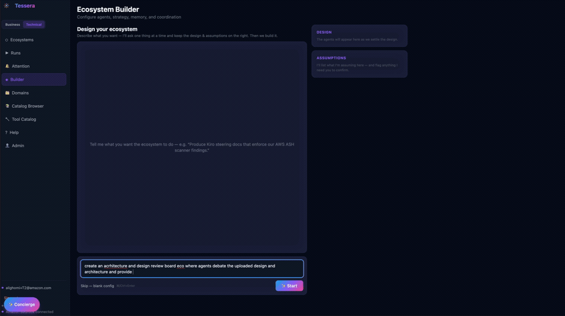
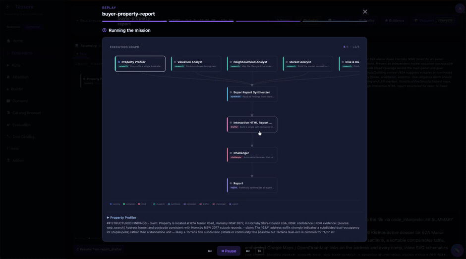
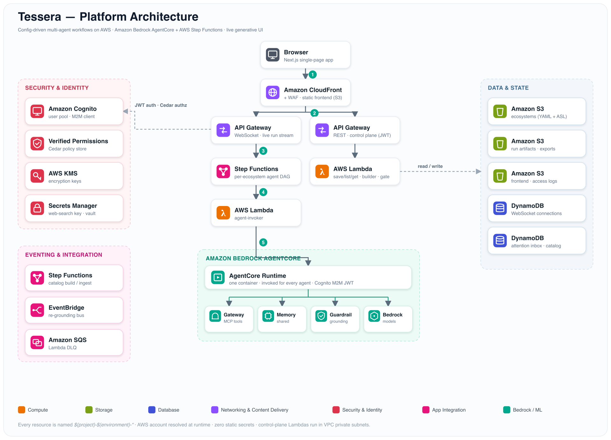
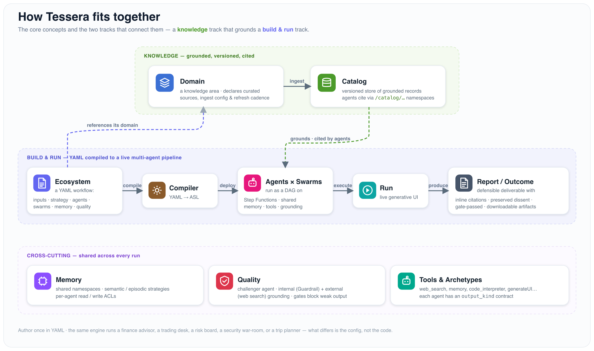

<p align="center">
  
</p>

<h1 align="center">Tessera</h1>

<p align="center">
  <strong>Multi-agent AI workflows on AWS, declared in YAML.</strong><br/>
  Compiled to AWS Step Functions, run on Amazon Bedrock AgentCore, streamed as live generative UI.
</p>

<p align="center">
  <a href="LICENSE"></a>
  = 1.11" src="https://img.shields.io/badge/Terraform-%E2%89%A5%201.11-7B42BC?logo=terraform&logoColor=white">
  
  
  
  <a href="https://aws-samples.github.io/sample-code-for-composable-agent-ecosystems/"></a>
  
</p>

<p align="center">
  <a href="#how-it-works">How it works</a> ·
  <a href="#core-concepts">Concepts</a> ·
  <a href="#why-tessera">Why Tessera</a> ·
  <a href="#deploy-tessera">Deploy</a> ·
  <a href="#where-to-go-next">Docs</a> ·
  <a href="#contributing">Contributing</a>
</p>

<p align="center">
  
  <br/>
  <sub><b>1 · Describe it.</b> <i>Tell the builder what you want in a sentence — it designs the agents, strategy, and quality posture with you.</i></sub>
</p>

<p align="center">
  
  <br/>
  <sub><b>2 · Run it.</b> <i>Launch, and watch the specialist agents stream across a live execution graph into a synthesizer, an adversarial challenger, and a final report.</i></sub>
</p>

<p align="center">
  <b>⭐ Find this useful?</b> <a href="https://github.com/aws-samples/sample-code-for-composable-agent-ecosystems/stargazers">Star the repo</a> — it helps other builders discover it. An official <a href="https://github.com/aws-samples">AWS Samples</a> project.
</p>

---

**Tessera** lets you build and run **multi-agent workflows — "ecosystems" — through configuration instead of code.** You describe the agents, how their work fits together, what they take in, and what they produce, all in YAML. Tessera compiles that into a runnable pipeline, executes it on AWS (Amazon Bedrock AgentCore + Step Functions), and streams a live, generative UI to a web frontend.

Ecosystems are **domain-agnostic**: the same engine powers a property due-diligence report, a commodity-trading desk, an enterprise risk board, an AI-governance assessment, a security incident war-room — and a trip planner. What ties them together is *how* they run: grounded in curated sources, pressure-tested by a challenger and quality gates, and defensible by design.

📚 **[Documentation](https://aws-samples.github.io/sample-code-for-composable-agent-ecosystems/)** — introduction, getting started, core concepts, guides, and reference.

## An ecosystem is just YAML

This is the ecosystem running in the demo above — a residential-buyer due-diligence report. Five researchers fan out in parallel, a synthesizer reconciles them, and a drafter renders a self-contained HTML report. *(prompts elided for brevity)*

```yaml
ecosystem:
  name: property-buyer-report
  description: Produce a due-diligence report for a prospective home buyer from an address.
  version: "1.0"

strategy: orchestrated              # agents run as a dependency graph
report: true                        # auto-inject the final report agent
quality: { challenger: true, grounding: true }   # adversarial review + grounding checks

outcome:
  kind: file_artifact
  artifacts: [{ id: buyer_report, agent: drafter, format: html }]

agents:
  - { id: property_facts, swarm: research, tools: [web_search, memory_write] }
  - { id: neighborhood,   swarm: research, tools: [web_search, memory_write] }
  - { id: market_comps,   swarm: research, tools: [web_search, memory_write] }
  - { id: risk,           swarm: research, tools: [web_search, memory_write] }
  - { id: title_legal,    swarm: research, tools: [web_search, memory_write] }

  - id: synthesizer                 # waits for the whole research swarm
    swarm: reasoning
    depends_on: [property_facts, neighborhood, market_comps, risk, title_legal]

  - id: drafter                     # renders the typed artifact
    swarm: drafting
    depends_on: [synthesizer]
    output_kind: drafter
    output_format: { type: html, save_as: property_buyer_report.html }

parallel_swarms: [research, reasoning, drafting]
```

Save it and Tessera compiles it to a Step Functions state machine, wires each agent to the shared AgentCore runtime, and injects a `challenger` and a `report` agent for you. See **[Anatomy of an ecosystem](docs/concepts/ecosystem-anatomy.png)**.

## How it works

<p align="center">
  
</p>

The frontend talks to a **WebSocket API** that launches a **Step Functions** state machine (one per ecosystem, compiled from your YAML). Each step invokes the **agent-invoker** Lambda, which calls a single **Amazon Bedrock AgentCore** runtime container — configured per request. Agents share a namespace-isolated **Memory**, reach tools through an **AgentCore Gateway** (MCP), and ground their claims against a **Bedrock Guardrail** and the catalog. Auth is **Cognito** + **Verified Permissions** (Cedar); there are **zero static secrets**.

## Core concepts

<p align="center">
  
</p>

| Concept | What it is | Diagram |
|---|---|---|
| **Ecosystem** | A YAML-declared multi-agent workflow, compiled to a Step Functions DAG. | [ecosystem-anatomy.png](docs/concepts/ecosystem-anatomy.png) |
| **Agents & archetypes** | Specialist agents configured per request; an `output_kind` contract (analyst, synthesizer, challenger, reporter, drafter, …) governs what each must produce. | [agent-archetypes.png](docs/concepts/agent-archetypes.png) |
| **Catalog** | A versioned, grounded knowledge store built from curated sources that agents cite. | [catalog-pipeline.png](docs/concepts/catalog-pipeline.png) |
| **Quorum** | A deliberating-panel strategy: empanel diverse personas → deliberate → scaled verdict with preserved dissent. | [quorum.png](docs/concepts/quorum.png) |

## Why Tessera

Code-first agent frameworks give you primitives and leave the hard parts — grounding, quality, UI, deployment — to you. Tessera is opinionated about exactly those parts, which makes it strong for **regulated, high-stakes work where outputs must hold up** (without being limited to it).

| | **Tessera** | Code-first frameworks<br/>(LangGraph · CrewAI · AutoGen) |
|---|---|---|
| Define a workflow | YAML config | Write & maintain Python |
| Grounding | Versioned **catalog** + internal/external grounding checks | Build it yourself |
| Quality | Built-in challenger, **quorum** deliberation, format/citation/grounding **gates** | Build it yourself |
| UI | **Live generative UI** streamed to a web app | None / build your own |
| Deployment | **Terraform** to your AWS account (dev/staging/prod) | Bring your own infra |
| Secrets | **Zero static secrets** (AgentCore vault / Secrets Manager) | Varies |
| Evaluation | Opt-in **eval harness** (regression + model-risk sign-off) | Build it yourself |

## Use cases

Because an ecosystem is **just configuration**, the use cases are effectively open-ended — anything you can describe as agents + how their work fits together. The engine is domain-agnostic: finance, security, governance, operations, research, or something no one's built yet.

The ecosystems below are **just samples** that ship in [`app/content/ecosystems/`](app/content/ecosystems) to get you started. Run them as-is, remix them, or **[build your own](https://aws-samples.github.io/sample-code-for-composable-agent-ecosystems/docs/guides/build-an-ecosystem)** — describe it to the builder in a sentence (as in the demo above) or write the YAML directly.

| Sample ecosystem | What it does |
|---|---|
| `property-buyer-report` | Due-diligence report for a home buyer from an address (the demo above). |
| `architecture-review-board` | A senior panel pressure-tests an AWS design → go / go-with-conditions / no-go (**quorum**). |
| `aws-ai-security-assessment-playbook` | Fail-closed AI security assessment grounded in OWASP, CSA MAESTRO & AGENTSEC controls. |
| `enterprise-risk-board` | Board-grade interrogation of a proposed decision with an accountable executive persona. |
| `ai-governance-conformity` | Jurisdiction-aware AI-governance conformity assessment. |
| `incident-war-room` | Live security-incident response simulation across coordinating specialists. |
| `commodity-trading-ecosystem` | A multi-desk commodity-trading analysis workflow. |
| `trip-planner` *(sample)* | A trip planner — proof the engine is domain-agnostic. |

> These are a starting point, not the catalog. **Your** ecosystem — your agents, your domain, your sources — is the point. See [Build an ecosystem](https://aws-samples.github.io/sample-code-for-composable-agent-ecosystems/docs/guides/build-an-ecosystem).

## Security posture

For a platform aimed at high-stakes work, security is a first-class concern:

- **Auth & authz:** Amazon Cognito for authentication; Amazon Verified Permissions (Cedar) for per-ecosystem authorization.
- **Network:** control-plane Lambdas run in a **VPC** (private subnets); the frontend sits behind **CloudFront + WAF**; S3 is private with Origin Access Control.
- **Grounding:** a **Bedrock Guardrail** (contextual grounding) plus external web cross-checks.
- **Secrets:** **none in the repo or env files** — credentials live in the AgentCore Identity token vault / Secrets Manager.
- **Encryption:** KMS throughout; least-privilege IAM per function.

## Repository layout

```
├── app/          Application code
│   ├── lambdas/     control-plane + ingest Lambda handlers (+ shared modules)
│   ├── platform/    shared platform package (tessera_platform.*)
│   ├── agent/       AgentCore runtime container
│   ├── frontend/    Next.js UI (static export)
│   ├── content/     ecosystems, domains, catalog content, templates (seed data)
│   └── tests/       unit / integration / ground-truth tests
├── infra/        Terraform — root module + child modules + per-environment config
├── scripts/      package-lambdas, deploy-agent, deploy-frontend, seed, create-admin
├── cicd/         GitLab CI/CD pipeline
├── docs/         in-repo documentation (start at docs/README.md)
├── docusaurus/   the documentation site published to GitHub Pages
└── Makefile      local + CI entrypoints (single source of truth)
```

## Prerequisites

- **Terraform** ≥ 1.11 (S3-native state locking)
- **AWS CLI v2**, authenticated to your target account
- **Python 3.12** and pip
- **Node.js 20+** and npm (Node 22 recommended)
- **jq**, **zip**, **openssl**
- The **`agentcore` CLI** — `pip install bedrock-agentcore-starter-toolkit`
- **Amazon Bedrock model access** enabled in your region for the models in `var.models`

Your AWS principal needs permission to create the full resource set (Lambda, API Gateway, DynamoDB, S3, CloudFront, WAF, Cognito, KMS, SQS, SNS, VPC, Step Functions, EventBridge, IAM, Verified Permissions, Bedrock/AgentCore, Secrets Manager). Full list: [docs/deployment/local-deployment.md](docs/deployment/local-deployment.md).

## Deploy Tessera

Terraform is run **directly** from `infra/` (not wrapped by `make`) so its output and errors are easy to read; `make` handles the surrounding steps.

```bash
# 1. Authenticate + configure
export AWS_PROFILE=your-profile
cp .env.example .env                    # set AWS_PROFILE / AWS_REGION / ENVIRONMENT
#    then set region = "..." in infra/environments/<env>/terraform.tfvars

# 2. One-time: create the Terraform state bucket
make bootstrap

# 3. Store the web-search API key (enable_websearch = true by default).
#    Get a free key from https://app.tavily.com/ :
make set-websearch-key ENV=dev          # or set enable_websearch = false to skip

# 4. Package the Lambdas, then apply Terraform
make package
source scripts/load-env.sh              # exports AWS creds + $TF_BACKEND / $TF_VARS
cd infra && terraform init $TF_BACKEND && terraform plan $TF_VARS && terraform apply $TF_VARS && cd ..

# 5. Deploy the AgentCore runtime, then re-apply to wire its ARN
make deploy-agent
cd infra && terraform apply $TF_VARS && cd ..

# 6. Publish the frontend, seed content, create the first admin
make deploy-frontend
make seed
make create-admin EMAIL=you@example.com
terraform -chdir=infra output -raw frontend_url    # open this URL
```

See the [local deployment guide](docs/deployment/local-deployment.md) for the full step-by-step, first-run defaults, and troubleshooting.

## First run

1. Open the `frontend_url` printed above and sign in with the admin account.
2. Pick an ecosystem from the home screen and fill in its inputs (text / select / file).
3. Launch, and watch the agent map stream in real time.
4. Review the generated report and (optionally) give inline feedback.

Populate the **catalog** so grounded lookups have data. This step is **required** (separate, long-running):

```bash
make ingest                             # or: make ingest DOMAINS="cyber-security-risk"
```

## Where to go next

### Use Tessera
- [Introduction](https://aws-samples.github.io/sample-code-for-composable-agent-ecosystems/docs/intro) and [Quick Start](https://aws-samples.github.io/sample-code-for-composable-agent-ecosystems/docs/getting-started/quick-start)
- [Build an ecosystem](https://aws-samples.github.io/sample-code-for-composable-agent-ecosystems/docs/guides/build-an-ecosystem) · [Evaluate an ecosystem](https://aws-samples.github.io/sample-code-for-composable-agent-ecosystems/docs/guides/evaluate-an-ecosystem)
- [Ecosystem YAML reference](https://aws-samples.github.io/sample-code-for-composable-agent-ecosystems/docs/reference/ecosystem-yaml)

### Understand the platform
- [How it works](https://aws-samples.github.io/sample-code-for-composable-agent-ecosystems/docs/core-concepts/architecture) · [Architecture (AWS services)](https://aws-samples.github.io/sample-code-for-composable-agent-ecosystems/docs/core-concepts/aws-architecture)
- Core concepts: [Ecosystems](https://aws-samples.github.io/sample-code-for-composable-agent-ecosystems/docs/core-concepts/ecosystems), [Domains](https://aws-samples.github.io/sample-code-for-composable-agent-ecosystems/docs/core-concepts/domains), [Catalog](https://aws-samples.github.io/sample-code-for-composable-agent-ecosystems/docs/core-concepts/catalog), [Evaluation](https://aws-samples.github.io/sample-code-for-composable-agent-ecosystems/docs/core-concepts/evaluation)

### Deploy & operate (in-repo docs)
- [Local deployment](docs/deployment/local-deployment.md) · [CI/CD deployment](docs/deployment/cicd-deployment.md)
- [Terraform architecture](docs/architecture/terraform-architecture.md) · [State backend](docs/deployment/state-backend.md)
- [Variables](docs/configuration/variables.md) · [Environments](docs/configuration/environments.md)
- [Admin setup](docs/operations/admin-user-setup.md) · [Seeding](docs/operations/seeding.md) · [Security scanning](docs/operations/security-scanning.md) · [Troubleshooting](docs/operations/troubleshooting.md)

## Contributing

See [CONTRIBUTING.md](CONTRIBUTING.md) before submitting changes.

## License

This project is licensed under the MIT-0 License. See [LICENSE](LICENSE).

---

<p align="center">
  If Tessera helps you build something, <a href="https://github.com/aws-samples/sample-code-for-composable-agent-ecosystems/stargazers">leave a ⭐</a> — and tell us what you built.
</p>
