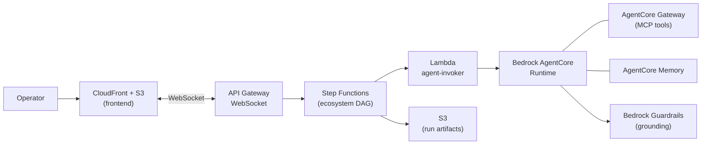
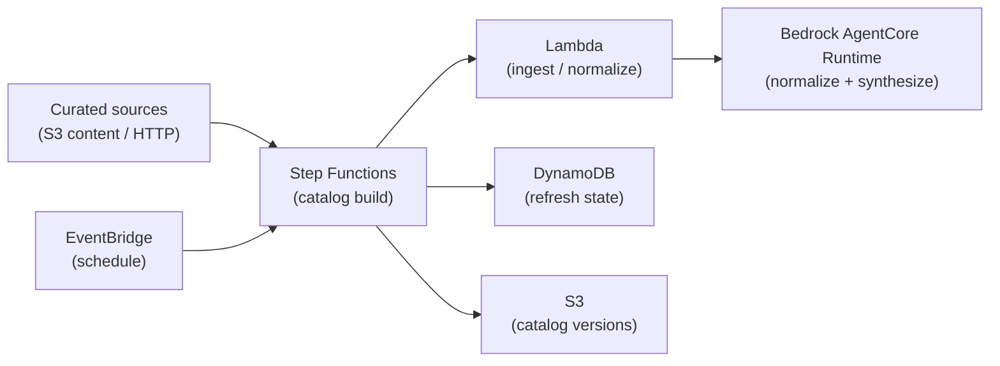
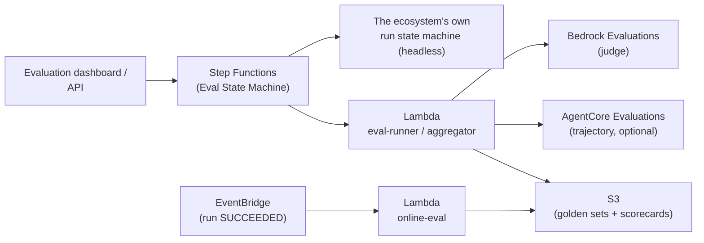
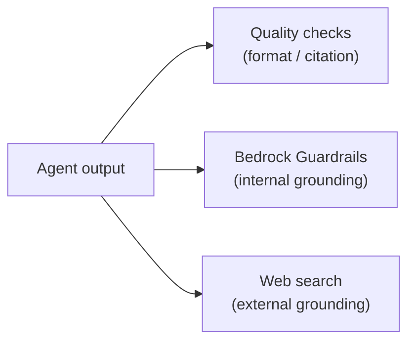
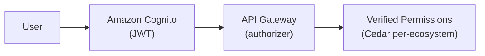
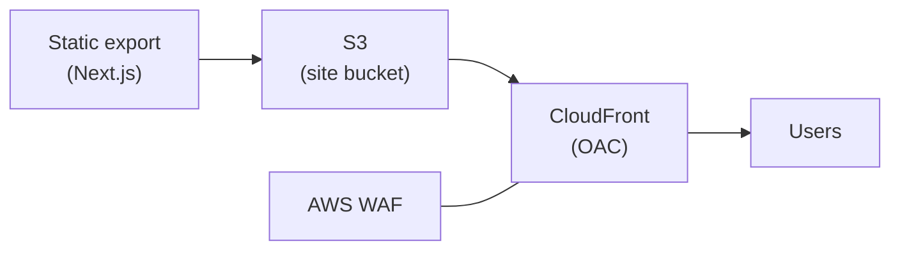

# Architecture

This page is a technical deep dive into the **AWS services** Tessera uses and **how each
feature uses them**. It is service-focused; for the conceptual run-path walkthrough see
[How it works](architecture.md), and for the infrastructure-as-code detail (Terraform
modules, deployment) see the repository's `docs/architecture/` and `docs/deployment/`.

## Service inventory

| Service | Role in Tessera |
|---------|-----------------|
| **Amazon Bedrock AgentCore — Runtime** | The single container that runs every agent, invoked per agent per run. |
| **Amazon Bedrock AgentCore — Gateway** | Exposes MCP tools to agents. |
| **Amazon Bedrock AgentCore — Memory** | Shared, namespace-isolated memory agents read/write within a run. |
| **Amazon Bedrock — Guardrails** | Contextual grounding checks on agent output (internal grounding). |
| **Amazon Bedrock — Evaluations** | LLM-as-judge scoring for the evaluation harness (`bedrock_judge`). |
| **Amazon Bedrock AgentCore — Evaluations** | Optional agent trajectory scoring in evaluation. |
| **AWS Step Functions** | One state machine per ecosystem (the agent DAG); plus catalog build and evaluation state machines. |
| **AWS Lambda** | Control-plane handlers, agent-invoker, catalog ingest/synthesis, and the evaluation Lambdas. |
| **Amazon API Gateway (REST + WebSocket)** | The JWT-authorized control plane and the live run stream. |
| **Amazon S3** | Ecosystems, run artifacts, golden sets/scorecards, the static frontend, and access logs. |
| **Amazon DynamoDB** | WebSocket connections, the human-attention inbox, and catalog refresh state. |
| **Amazon CloudFront + AWS WAF** | Delivers the static frontend; WAF protects the distribution. |
| **Amazon Cognito** | User authentication (user pool, app clients, M2M client). |
| **Amazon Verified Permissions** | Per-ecosystem authorization with Cedar policies. |
| **Amazon EventBridge** | Fires online evaluation when a run completes; catalog schedules. |
| **AWS Secrets Manager + AgentCore Identity** | Zero-static-secret credential storage (e.g. the web-search key). |
| **AWS KMS** | Encryption keys for data at rest. |
| **Amazon VPC** | Network isolation for the Lambdas. |

## Feature → services

### Running an ecosystem

The WebSocket API starts the ecosystem's Step Functions state machine; each agent is
invoked on the AgentCore Runtime, using Gateway tools and shared Memory. Grounding uses
Bedrock Guardrails; artifacts land in S3.

### Catalog ingest & synthesis

The catalog build state machine ingests sources, normalizes/synthesizes them via the
AgentCore Runtime, tracks refresh state in DynamoDB, and promotes versions in S3. See
[Catalog](catalog.md).

### Evaluation

The Eval State Machine runs the ecosystem headlessly over the golden set, scoring with
deterministic scorers plus Bedrock/AgentCore Evaluations, and writes scorecards to S3.
Online eval is triggered off completed runs by EventBridge. See
[Evaluation](evaluation.md).

### Quality & grounding

### Auth & authorization

Cognito authenticates; API Gateway validates the JWT; Verified Permissions authorizes each
ecosystem action against Cedar policies. See [Share an ecosystem](../guides/share-an-ecosystem.md).

### Frontend delivery

## Data & state

| Data | Store |
|------|-------|
| Ecosystems (YAML) | S3 |
| Run artifacts / reports | S3 |
| Golden sets + scorecards | S3 |
| WebSocket connections | DynamoDB |
| Human-attention inbox | DynamoDB |
| Catalog refresh state | DynamoDB |
| Agent working memory | AgentCore Memory |
| Static frontend | S3 (served via CloudFront) |

## Security posture

- **Network** — Lambdas run in a VPC; the frontend is fronted by CloudFront with AWS WAF.
- **Encryption** — data at rest is encrypted with KMS; S3 buckets are private (CloudFront
  uses Origin Access Control).
- **Authorization** — every ecosystem action is authorized per-ecosystem with Amazon
  Verified Permissions (Cedar).
- **Zero static secrets** — credentials (e.g. the web-search key) live in Secrets Manager /
  the AgentCore Identity token vault, never in the repo or environment files.

:::note
This page covers the **services**. The Terraform modules that provision them, the
dependency graph, and deployment steps are in the repository's `docs/architecture/` and
`docs/deployment/`.
:::
